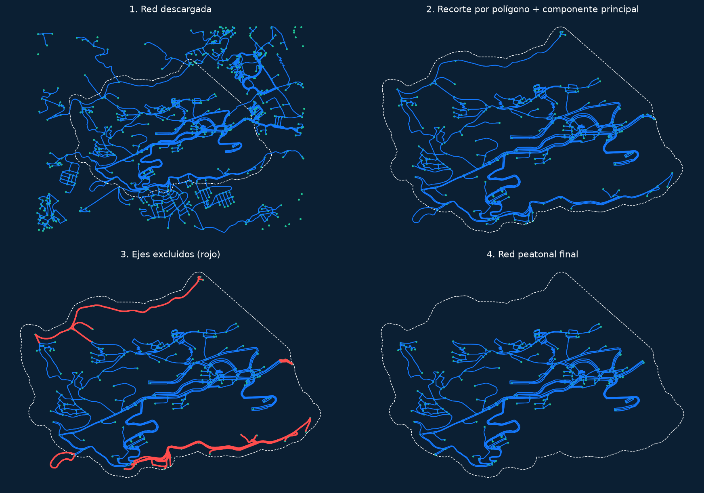
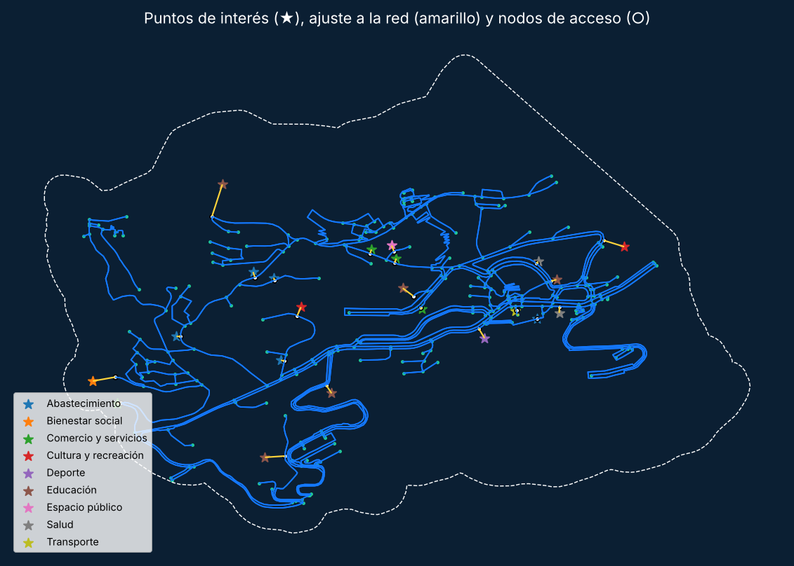

# Semillero SUT

## Modelación computacional de caminabilidad en La Aurora (Medellín)

**Autor:** Santiago Ayala Martínez · Semillero SUT 2026

---

## 📖 Descripción

Este repositorio documenta el flujo computacional del análisis de **caminabilidad y accesibilidad peatonal** en el sector de **La Aurora** (Medellín). El proceso parte de la red peatonal de OpenStreetMap y termina con un grafo limpio, con los **puntos de interés integrados como nodos**, listo para calcular índices topológicos (centralidad, conectividad, morfología) y de accesibilidad (A<sub>ik</sub>, SAWI).

El repositorio también incluirá el **análisis en Python de las encuestas** aplicadas a peatones en La Aurora (en construcción), en la carpeta `Analisis_de_encuestas/`.



## 🔁 Flujo de trabajo

| Paso | Qué se hace | Función (`src/red_peatonal.py`) |
|---|---|---|
| 1 | Descarga de la red `walk` de OSM dentro del territorio + 300 m (o carga de la red AMVA ya guardada) | `descargar_red`, `cargar_red_desde_gpkg` |
| 2 | Recorte por el polígono del territorio de análisis (límite + buffer de 20 m) | `recortar_red` |
| 3 | Exclusión de los ejes retirados a mano en QGIS (lista en CSV, editable) | `aplicar_exclusiones` |
| 4 | Eliminación de nodos y ejes que no conectan con la red (se conserva el componente principal) | `conservar_componente_principal` |
| 5 | Proyección a EPSG:9377, recálculo de `street_count` y verificación | `recalcular_street_count`, `verificar_red` |
| 6 | Integración de los puntos de interés: cada POI se proyecta sobre la arista más cercana, que se divide para crear un nodo de acceso | `integrar_pois` |
| 7 | Exportación a GeoPackage (QGIS) y GraphML (Python) | `exportar_red` |

Todo el proceso está explicado y ejecutado en el notebook [`Notebooks/Proceso_y_uso_de_OSMNX.ipynb`](Notebooks/Proceso_y_uso_de_OSMNX.ipynb).



## 📂 Estructura del repositorio

```
Semillero-SUT/
├── Notebooks/
│   └── Proceso_y_uso_de_OSMNX.ipynb      # Notebook principal (paso a paso)
├── src/
│   └── red_peatonal.py                   # Funciones del flujo (reutilizables)
├── GPKG/
│   ├── Descargas/                        # Redes descargadas de OSM con OSMnx
│   │   ├── Medellin.gpkg                 #   polígono del municipio
│   │   ├── Walk_nodes_AMVA.gpkg          #   nodos de la red peatonal del AMVA
│   │   └── Walk_edges_AMVA.gpkg          #   ejes de la red peatonal del AMVA (~63 MB)
│   └── Aurora/
│       ├── Entradas/                     # Insumos del análisis
│       │   ├── Territorio_de_analisis_Aurora.gpkg
│       │   ├── Puntos_de_interes_Aurora.gpkg
│       │   ├── Construcciones_Aurora.gpkg       (catastro, EPSG:9377)
│       │   └── Exclusiones_manuales_Aurora.csv  (ejes retirados en QGIS)
│       ├── Referencia_QGIS/              # Red filtrada a mano en QGIS (para validar)
│       │   ├── Nodos_Aurora.gpkg
│       │   └── Ejes_primarios_Aurora.gpkg
│       └── Resultados/                   # Salidas del notebook
│           ├── Red_Aurora.gpkg / .graphml        (red limpia, sin POIs)
│           └── Red_Aurora_POIs.gpkg / .graphml   (red con POIs integrados)
├── Analisis_de_encuestas/
│   └── Analisis de encuesta.ipynb        # Análisis de las encuestas (en construcción)
├── Images/                               # Figuras del notebook y del README
├── environment.yml
├── .gitignore
└── README.md
```

### Salidas

| Archivo | Capas | Uso |
|---|---|---|
| `Red_Aurora.gpkg` | `nodos`, `ejes` | Índices de morfología y centralidad (red **sin** POIs, para no alterar grados ni intersecciones) |
| `Red_Aurora_POIs.gpkg` | `nodos`, `ejes`, `pois`, `lineas_ajuste` | Accesibilidad a servicios y revisión del ajuste de cada POI en QGIS |
| `*.graphml` | grafo completo | Volver a cargar la red en Python: `ox.io.load_graphml(ruta)` |

Todas las capas de resultados están en **EPSG:9377** (MAGNA-SIRGAS Origen Nacional). En la red con POIs, los nodos creados tienen id negativo y el atributo `tipo_nodo = "poi"`.

## ⚙️ Requisitos e instalación

El proyecto usa Python a través de un entorno de **conda**:

```bash
conda env create -f environment.yml
conda activate ox
```

O, si ya tienes el entorno `ox`:

```bash
conda create --strict-channel-priority -c conda-forge -n ox osmnx jupyterlab
```

Librerías principales: [`osmnx`](https://osmnx.readthedocs.io/) 2.1, [`networkx`](https://networkx.org/), [`geopandas`](https://geopandas.org/), `matplotlib` y `jupyterlab`.

## 🚀 Uso

```bash
git clone https://github.com/Ayalasant/Semillero-SUT.git
cd Semillero-SUT
conda activate ox
jupyter lab
```

Abre `Notebooks/Proceso_y_uso_de_OSMNX.ipynb` y ejecuta todas las celdas. Hay dos opciones al inicio:

- `EJECUTAR_EJEMPLOS = False`: los ejemplos de descarga de todo Medellín/AMVA (lentos) muestran la figura guardada en lugar de descargar.
- `DESCARGAR = False`: usa la red AMVA guardada en `GPKG/Descargas/`, así todo el equipo trabaja con la misma versión de la red. Con `True` se descarga de nuevo desde OpenStreetMap; en ese caso los ids pueden cambiar y conviene revisar el CSV de exclusiones.

Para cambiar qué ejes se retiran de la red, edita `GPKG/Aurora/Entradas/Exclusiones_manuales_Aurora.csv` (columnas `u`, `v`, `key` de OSM). Para cambiar las categorías de los POIs, edita el diccionario `categorias` de la sección 4.1 del notebook.

## 🗺️ Zona de estudio

Red peatonal de **La Aurora, Medellín, Antioquia, Colombia**: territorio de 1,56 km² (límite político-administrativo con buffer de 20 m, incluida la zona de la estación del Metrocable). La red final tiene 297 nodos y 27 km de calles peatonales, y se le integraron 23 puntos de interés.

## 📚 Referencias

- Boeing, G. (2017). OSMnx: New methods for acquiring, constructing, analyzing, and visualizing complex street networks. *Computers, Environment and Urban Systems*, 65, 126–139.
- Porta, S., Crucitti, P. y Latora, V. (2006). The network analysis of urban streets: a primal approach. *Environment and Planning B*, 33(5), 705–725.
- Riascos-Goyes, J. F., Lowry, M., Guarín-Zapata, N. y Ospina, J. P. (2025). Street network sub-patterns and travel mode. arXiv:2507.19648.
- Miranda-Parra, S. M. y Ospina, J. P. (2026). Assessment of simultaneous accessibility walking index (SAWI) to essential opportunities. *Cities*, 173, 106885.
- Valdivia Pallares, R. et al. (2026). Is the accessible truly walkable? Does proximity to services translate into walking? *Cities*, 179, 107448.

---

*Proyecto desarrollado en el marco del Semillero SUT 2026.*
